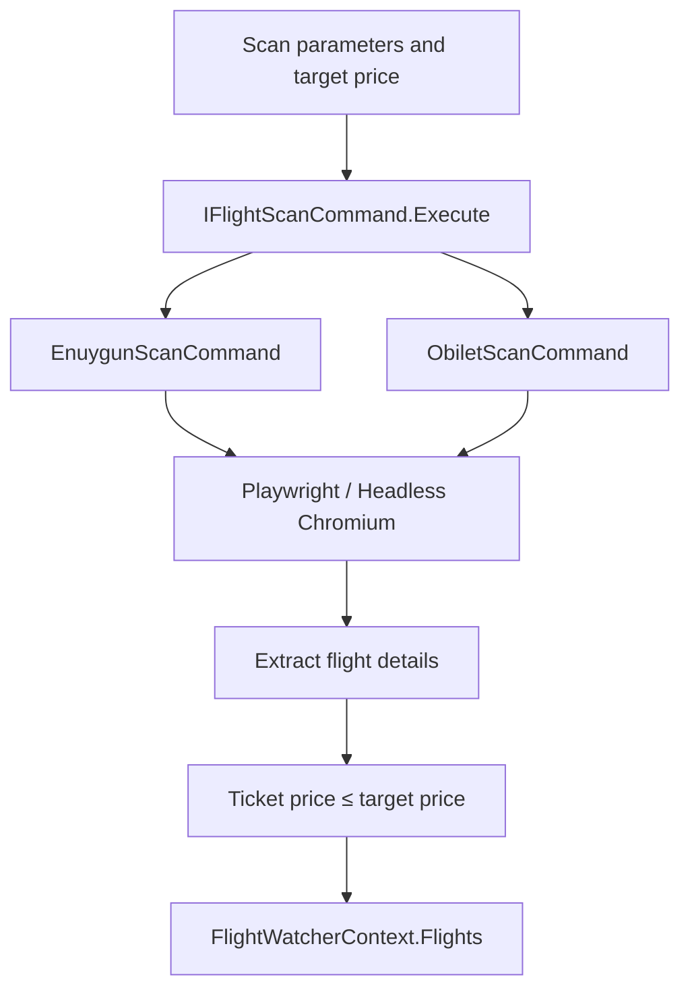

<div align="center">

# FlightWatcher

### A modular flight price tracking tool powered by browser automation

FlightWatcher searches flight providers for tickets that match your route, travel dates, passenger preferences, and target price.

<br />


</div>

---

## Overview

**FlightWatcher** is a .NET console application being developed to simplify flight price monitoring across multiple providers.

The project includes browser automation implementations for **Enuygun** and **Obilet**. These implementations search for flights, extract flight details, and collect tickets priced at or below a configured target.

Its long-term goal is to monitor prices at regular intervals and notify users when matching tickets become available.

### Current development status

- Enuygun and Obilet scan implementations are available in the Infrastructure project.
- Matching flights are collected in memory.
- The console application displays a styled welcome screen and an input prompt.
- Console commands are not yet connected to the scanning implementations.
- Scheduled scanning and notifications are planned; they are not currently implemented.

---

## Features

### Provider-based flight searches

- Separate scan implementations for Enuygun and Obilet
- A shared `IFlightScanCommand` interface
- Headless Chromium automation with Microsoft Playwright
- Provider-specific search URL generation
- Departure date and optional return date parameters
- One-way and round-trip search requests

The current result parsers collect outbound flight results. Round-trip search parameters do not yet provide complete outbound and return itinerary processing.

### Target price filtering

- Configurable maximum ticket price
- Inclusive price comparison: `TicketPrice <= TargetPrice`
- Turkish number-format parsing for provider prices
- Collection of matching flights in a shared in-memory context

### Flight details

Matching flight records contain:

- Airline
- Departure time
- Arrival time
- Departure airport name and code
- Arrival airport name and code
- Ticket price

### Passenger preferences

The domain model supports:

- Adults
- Children
- Students
- Passenger counts for each category

Passenger parameters are translated into the format expected by each provider.

### Console interface

- Spectre.Console integration
- Centered FlightWatcher banner
- Turkish introductory text
- Styled interactive input area

---

## Architecture

FlightWatcher separates its domain models, application contracts, provider integrations, and console entry point into four projects.

| Project | Responsibility |
|---|---|
| **FlightWatcher** | Console entry point and terminal interface |
| **FlightWatcher.Core** | Flight models, target ticket criteria, passenger types, and provider models |
| **FlightWatcher.Application** | Scan contracts, facade contract, and shared in-memory context |
| **FlightWatcher.Infrastructure** | Playwright integrations and facade implementation |

The current scanning implementations follow this workflow:



The console entry point is not yet wired into this workflow.

### Project dependencies

```text
FlightWatcher.Infrastructure
└── FlightWatcher.Application
    └── FlightWatcher.Core

FlightWatcher
└── Spectre.Console
```

The console project currently has no project reference to the scanning layers.

---

## Providers

| Provider | Implementation | Details |
|---|---|---|
| **Enuygun** | `EnuygunScanCommand` | Builds search URLs, filters results by airport codes and target price, and extracts flight details |
| **Obilet** | `ObiletScanCommand` | Resolves location IDs through the search page, builds search URLs, and extracts flights within the target price |

### Passenger mapping

| Passenger type | Enuygun | Obilet |
|---|---|---|
| **Adult** | Included in adult count | `a` parameter |
| **Child** | Included in child count | `c` parameter |
| **Student** | Included in adult count | `s` parameter |

Both integrations currently generate economy-class searches.

---

## Technology stack

| Category | Technology |
|---|---|
| **Runtime** | .NET 10 |
| **Language** | C# |
| **Application type** | Console application |
| **Terminal UI** | Spectre.Console 0.57.2 |
| **Browser automation** | Microsoft.Playwright 1.62.0 |
| **Browser engine** | Headless Chromium |
| **Architecture** | Layered projects with command and facade abstractions |
| **Runtime state** | In-memory collections |

The solution also references **Hangfire.Core 1.8.25**, **Hangfire.InMemory 1.0.0**, and **Newtonsoft.Json 13.0.4**. These packages are not currently wired into an active scheduling or serialization workflow.

---

## Project structure

```text
FlightWatcher/
├── FlightWatcher/
│   ├── FlightWatcher.csproj
│   └── Program.cs
│
├── FlightWatcher.Application/
│   ├── Contexts/
│   │   └── FlightWatcherContext.cs
│   ├── Interfaces/
│   │   ├── IFlightScanCommand.cs
│   │   └── IFlyingWatcherFacade.cs
│   └── FlightWatcher.Application.csproj
│
├── FlightWatcher.Core/
│   ├── Enums/
│   │   └── PersonType.cs
│   ├── Models/
│   │   ├── Providers/
│   │   │   ├── Enuygun.cs
│   │   │   └── Obilet.cs
│   │   ├── Flights.cs
│   │   ├── Passenger.cs
│   │   └── TargetTicket.cs
│   └── FlightWatcher.Core.csproj
│
├── FlightWatcher.Infrastructure/
│   ├── Commands/
│   │   ├── EnuygunScanCommand.cs
│   │   └── ObiletScanCommand.cs
│   ├── Facades/
│   │   └── FlyingWatcherFacade.cs
│   └── FlightWatcher.Infrastructure.csproj
│
├── .gitignore
└── FlightWatcher.slnx
```

The solution contains **four projects** and **one console entry point**.

---

## Getting started

### Prerequisites

- [.NET 10 SDK](https://dotnet.microsoft.com/download/dotnet/10.0)
- Git
- Internet access for dependency restoration and provider searches
- PowerShell for the Playwright browser installation command below

Check the installed SDK:

```bash
dotnet --version
```

Use an SDK that supports the solution's `net10.0` target framework.

### Clone the repository

```bash
git clone https://github.com/emreucbudak/FlightWatcher.git
cd FlightWatcher
```

### Restore dependencies

```bash
dotnet restore FlightWatcher.slnx
```

### Build the solution

```bash
dotnet build FlightWatcher.slnx
```

### Run the console application

```bash
dotnet run --project FlightWatcher/FlightWatcher.csproj
```

This opens the current console interface. Entered text does not yet execute flight searches.

### Install Chromium for provider scans

After building the solution, install the browser used by the scanning implementations:

```powershell
pwsh FlightWatcher.Infrastructure/bin/Debug/net10.0/playwright.ps1 install chromium
```

The path above assumes a default Debug build.

---

## Scan parameters

Both provider implementations expose the same method through `IFlightScanCommand`:

```csharp
Task Execute(
    string from,
    string to,
    DateOnly departureDay,
    bool isOneWay,
    IList<Passenger> passengers,
    DateOnly? returnDay = null);
```

| Parameter | Description |
|---|---|
| `from` | Origin text in the format expected by the provider |
| `to` | Destination text in the format expected by the provider |
| `departureDay` | Outbound travel date |
| `isOneWay` | Whether the search is one-way |
| `passengers` | Passenger categories and counts |
| `returnDay` | Return date, required for round-trip searches |

Enuygun expects airport text in this format:

```text
Şehir, Türkiye KOD - Havalimanı
```

For example:

```text
İstanbul, Türkiye SAW - Sabiha Gökçen Havalimanı
```

Obilet resolves location IDs from its origin and destination search fields.

Before invoking a scan, application code must set:

```csharp
FlightWatcherContext.TargetTicket.TargetPrice
```

Matching records are added to:

```csharp
FlightWatcherContext.Flights
```

The scanners append to this collection. Callers must manage when previous results are cleared.

---

## Data model

### Target ticket

`TargetTicket` represents the requested travel criteria:

| Property | Purpose |
|---|---|
| `Location` | Origin |
| `Destination` | Destination |
| `TargetPrice` | Maximum accepted ticket price |
| `LandedDay` | Travel date field |
| `ReturnDay` | Optional return date |
| `Passengers` | Passenger preferences |

### Flight result

`Flights` represents an extracted flight:

| Property | Purpose |
|---|---|
| `Airline` | Airline name |
| `DepartureTime` | Departure time |
| `ArrivedTime` | Arrival time |
| `TicketPrice` | Integer ticket price |
| `DepartureAirport` | Departure airport name |
| `DepartureAirportCode` | Departure airport code |
| `ArrivalAirport` | Arrival airport name |
| `ArrivalAirportCode` | Arrival airport code |

Prices are currently stored as integers. Currency and fractional amounts are not represented separately.

---

## Runtime state

FlightWatcher currently stores target criteria and matching flights in a static, in-memory application context.

- No database is configured.
- Results are not persisted between application runs.
- No `appsettings.json` configuration is currently included.
- Scan parameters are supplied through the application interfaces.

---

## Planned capabilities

The intended monitoring workflow includes:

- Connecting console commands to provider scans
- Starting scans through `/taramayibaslat`
- Repeating searches at configured intervals
- Notifying users when tickets meet their target price

The facade already contains explanatory text for this workflow, but `FlyingWatcherFacade.StartScan()` is currently empty.

---

## Development notes

Provider integrations read flight information from website HTML using Playwright selectors. Changes to provider pages may require updates to those selectors.

The repository currently contains no automated test project.

---

## Contributing

1. Fork the repository.
2. Create a feature branch.

```bash
git checkout -b feature/your-feature-name
```

3. Implement your changes.
4. Build the solution.

```bash
dotnet build FlightWatcher.slnx
```

5. Verify the affected functionality.
6. Open a pull request describing the change.

---

<div align="center">

Built with **.NET 10**, **Playwright**, and **Spectre.Console**.

</div>
